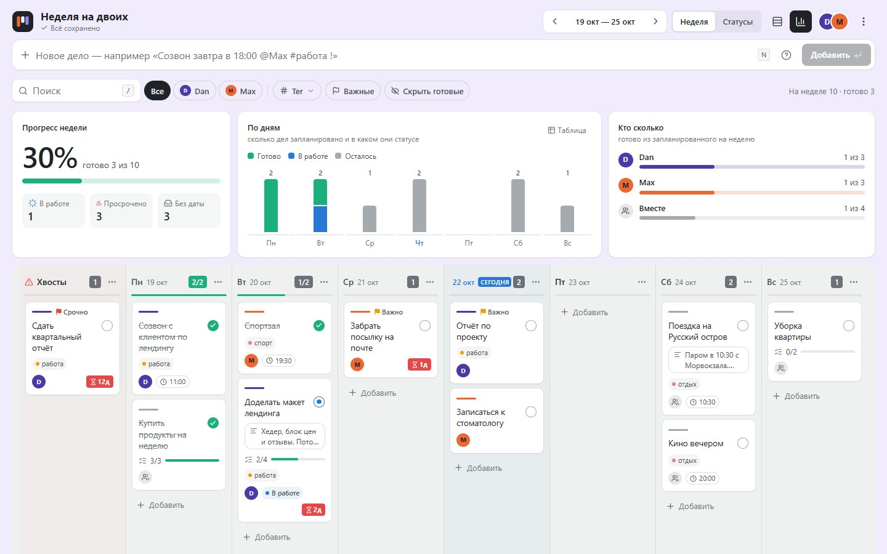
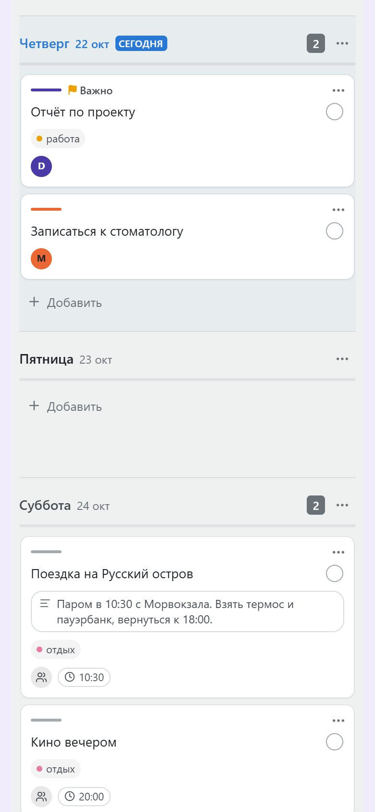

<div align="center">



# Неделя на двоих

**Канбан-доска на неделю для двоих: вход по секретной ссылке, realtime, drag and drop.**

     

<a href="https://duo-week.vercel.app"></a>

</div>

<table>
<tr>
<td align="center" valign="top"></td>
</tr>
</table>

<!-- header:end -->
Канбан-доска на неделю для двух человек. Без регистрации: вход по секретной ссылке-приглашению, изменения прилетают обоим в реальном времени.

**Демо:** https://duo-week.vercel.app

## Что умеет

- **Доступ по ссылке.** Ключ доски передаётся в заголовке `x-board-key` и проверяется политиками RLS в Supabase, аккаунты не нужны.
- **Drag and drop** между днями, статусами и дорожками участников (dnd-kit), с оптимистичными обновлениями.
- **Быстрое добавление с разбором текста:** `Купить билеты @Макс #поездка ! завтра 18:30` → исполнитель, тег, приоритет, дата и время.
- **Карточка задачи:** чек-лист, теги, время, приоритет; отмена удаления.
- **Статистика недели:** прогресс, столбцы по дням, вклад каждого участника.
- **Мгновенное открытие:** последний снимок доски кэшируется локально, свежие данные подтягиваются следом.

## Стек

React 19 · TypeScript · Vite · Tailwind CSS 4 · dnd-kit · Supabase (Postgres, RLS, Realtime) · Vitest · Oxlint · Vercel

## Запуск

```bash
npm install
cp .env.example .env.local   # вписать URL и anon-ключ своего проекта Supabase
npm run dev
npm test                     # юнит-тесты парсера и сортировки
```

Посмотреть интерфейс без Supabase можно через `demo.html`: там доска работает на in-memory-бэкенде (`src/api/memory.ts`).
